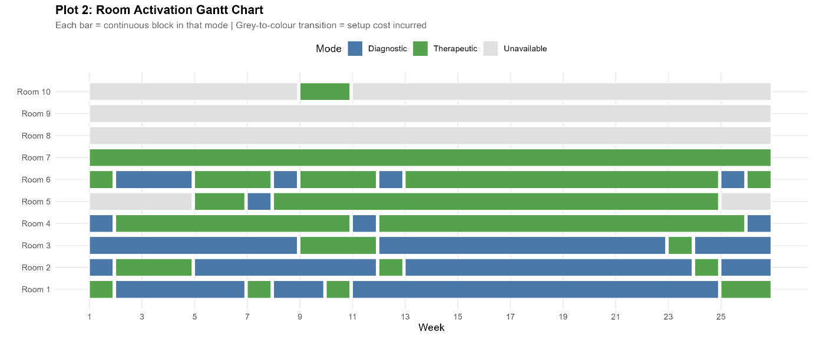
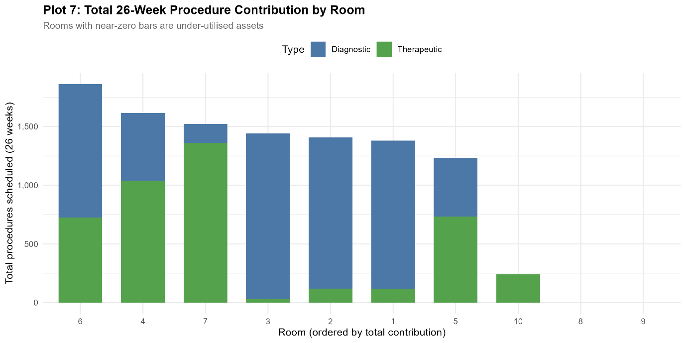
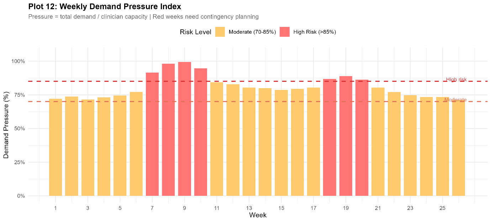

# Hospital Endoscopy Capacity Optimisation (MILP)

A mixed-integer linear programme that plans 10 endoscopy rooms over 26 weeks for a teaching hospital's GI unit, meeting every week of patient demand at the lowest possible cost.



## Results at a glance

| Measure | Result |
|---|---|
| Patient demand met | 100% of diagnostic and therapeutic hours, every week |
| Minimum 26-week cost | £2,265,600 (93.4% running cost, 6.6% one-off setup) |
| Optimality gap | 0.009%, so no cheaper room plan exists within solver tolerance |
| Rooms needed | 7 of 10; large Rooms 8 and 9 are never used |
| Highest-risk weeks | Weeks 7 to 10, when demand uses over 85% of clinician hours |

## Business problem

Each week, the unit decides which rooms to open, whether each runs in diagnostic or therapeutic mode, and how many procedure hours to schedule. Opening a room costs £15,000 to £25,000, and each open room costs £180 to £220 per configured bay-hour whether or not the hours are used. The plan must meet all demand without exceeding weekly clinician availability (470 to 530 hours).

## Approach

- **Decision variables:** binary room-mode switches, continuous scheduled hours, and a binary setup trigger for each room and week (1,300 variables in total).
- **Objective:** minimise allocation cost plus setup cost over 26 weeks.
- **Constraints:** one mode per room, diagnostic and therapeutic demand, therapeutic work only in therapeutic rooms, room capacity, clinician capacity, and setup costs triggered only when a room switches from idle to active.
- **Solver:** HiGHS (branch-and-bound) through `ompr` and `ROI` in R.
- **Validation:** every weekly constraint is re-checked from the solution, and the weekly cost breakdown is reconciled against the solver's objective value.

## Key findings



- Four rooms (4, 6, 7 and one small room) deliver about 70% of all procedure hours. Room 7 runs in therapeutic mode all 26 weeks, which makes it the most critical asset.
- Rooms 8 and 9 add no value over the planning horizon, so the hospital can reallocate them to other specialities.
- Clinician hours, not rooms, are the binding constraint in Weeks 7 to 10, so locum cover should be arranged before Week 6.
- Toggling rooms on and off costs more than £20,000 per cycle, so the optimal plan keeps rooms open in long continuous blocks.



## Tools

R · ompr · ROI · HiGHS · dplyr · tidyr · ggplot2 · patchwork

## Repository structure

```
├── endoscopy_milp.R                              # model, solve, validation, 12 plots and an executive dashboard
├── Hospital_Endoscopy_Capacity_Optimisation.pdf  # full written report
└── *.png                                         # figures used in this README
```

## How to run

All input data is defined inside the script, so no external files are needed.

```r
install.packages(c("ompr", "ompr.roi", "ROI", "ROI.plugin.highs",
                   "dplyr", "tidyr", "ggplot2", "patchwork", "scales"))
source("endoscopy_milp.R")
```

Plots, tables and the solver log are saved to `outputs/`.

## Report

The full report, including the model formulation and a review of a branch-price-and-cut scheduling paper, is in [Hospital_Endoscopy_Capacity_Optimisation.pdf](Hospital_Endoscopy_Capacity_Optimisation.pdf).

---

MSc Business Analytics coursework, Data-Driven Decision Making module, Queen's University Belfast (2026). By [Harsh Vikram Singh](https://www.linkedin.com/in/harsh-vikram-singh-20b455241/).
